# TopHatt

[🇬🇧 English](README.md) | 🇩🇪 **Deutsch**

TopHatt ist ein Spieltags-Cockpit für [Hattrick](https://www.hattrick.org). Es liest die Daten aus
Hattrick Organizer (HO), schlägt Aufstellung, Taktik und Wechsel für das nächste Spiel vor und schreibt
das Ergebnis als HRF-Datei zurück, die HO zu Hattrick hochlädt. Alles läuft lokal im Browser, hell oder dunkel.

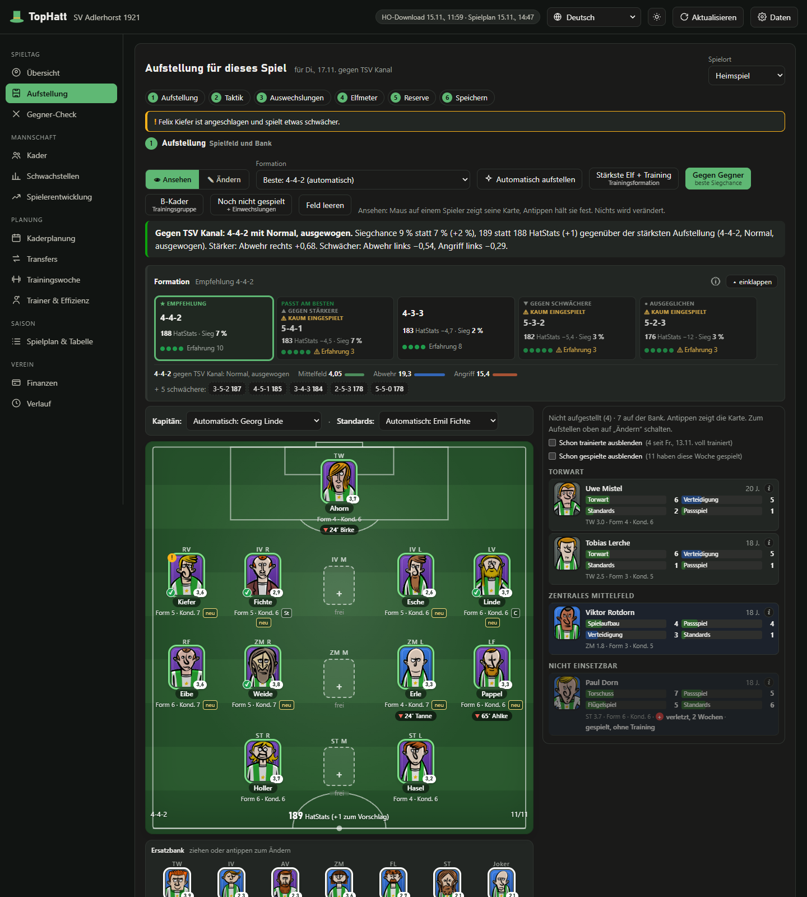

<sub>Alle Screenshots zeigen einen erfundenen Verein mit erfundenen Spielern und Werten; die Spielerbilder sind Hattrick-Avatare aus HO.</sub>

**Inhalt:** [Die Seiten](#die-seiten) · [Installieren](#installieren) · [Benutzen](#benutzen) · [Aufbau](#aufbau) · [Entwickeln](#entwickeln) · [Lizenz](#lizenz)

## Die Seiten

Die Seiten folgen dem Menü links in der App. Jeder Abschnitt lässt sich aufklappen.

### Spieltag

<details open>
<summary><b>Übersicht</b>: das nächste Spiel auf einen Blick</summary>
<br>

Gegner, Anstoß, erwartete HatStats, Formation, größte Schwachstelle und die nächsten Spiele. Darunter Kacheln, die
direkt zur passenden Seite führen.

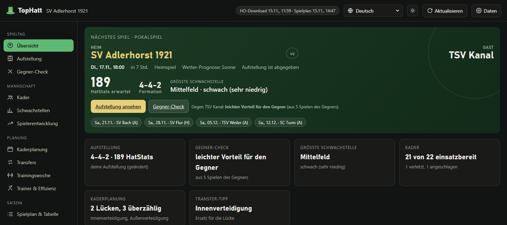
</details>

<details open>
<summary><b>Aufstellung</b>: in sechs Schritten zur fertigen HRF-Datei</summary>
<br>

Spielfeld wie in HO (Torwart oben). Oben springt man über die nummerierten Knöpfe zu den Bereichen.

<details open>
<summary>1 · Spielfeld und Bank</summary>
<br>

- Formationsvorschlag als Karten, eingespielte Formationen zuerst; „Automatisch aufstellen“, „Trainingself“, „Feld leeren“.
- **Ansehen/Ändern**: Im Ansehen-Modus zeigt ein Spieler beim Darüberfahren seine Karte, Antippen hält sie fest, nichts
  verschiebt sich versehentlich. Im Ändern-Modus Spieler ziehen oder antippen; die Linien zeigen, wo er am besten passt.
- Rahmenfarbe = Eignung für die Position, Kreisfarbe = Kader (A lila, B blau, Rest grau), Pfeile = geplante Wechsel mit Minute.

**Spieler angeklickt:** Die Spielerkarte zeigt Alter, TSI, Gehalt, Form, Kondition, alle Fähigkeiten, die besten
Positionen (in denselben Farben wie die Linien auf dem Feld) und die letzte Bewertung.

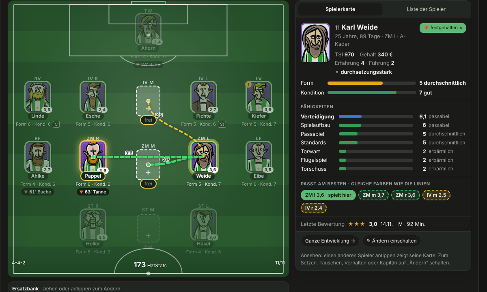
</details>

<details>
<summary>2 · Taktik</summary>
<br>

Empfehlung für Taktik, Einstellung und Ausrichtung aus der HO-Spielvorhersage gegen die Gegnerstärke, mit Sieg-,
Remis- und Niederlagenchance. Ausrichtungen gibt es nur, soweit Trainertyp und Taktik-Assistenten sie erlauben.

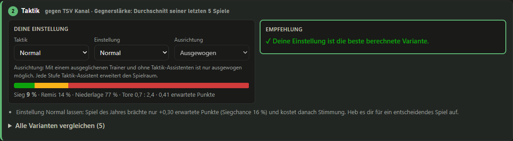
</details>

<details>
<summary>3 · Auswechslungen und Anweisungen</summary>
<br>

Vorschläge nach Kondition, Training und Einsatzzeit mit den Zielen **Sieg**, **Ausgewogen** oder **Training**.
**Automatisch** passt die Wechsel jeder Änderung der Aufstellung an, **Manuell** lässt sie stehen. Darunter die
Anweisungen wie in HO; was nicht mehr zur Aufstellung passt, wird markiert.

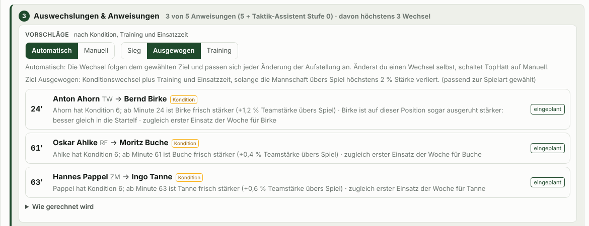
</details>

<details>
<summary>4 · Elfmeterschützen</summary>
<br>

Reihenfolge wie in HO aus Erfahrung, Standards und Torschuss, automatisch oder von Hand sortiert.

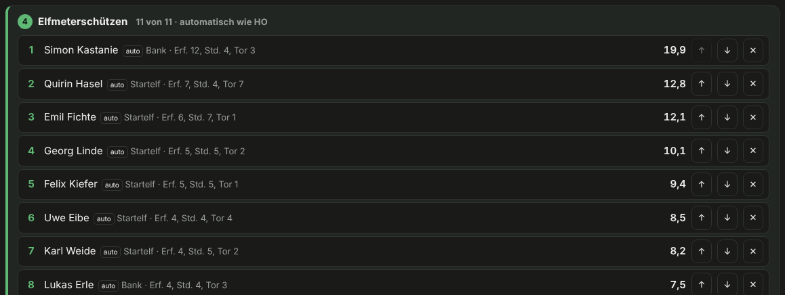
</details>

<details>
<summary>5 · Reserve und 6 · Speichern</summary>
<br>

Die Reserve ist die zweite Bankreihe: automatisch der stärkste andere Bankspieler je Position. „Für HO speichern“
schreibt eine HRF-Datei mit Aufstellung, Taktik, Kapitän, Standards, Bank, Reserve, Elfmeterschützen und Anweisungen.

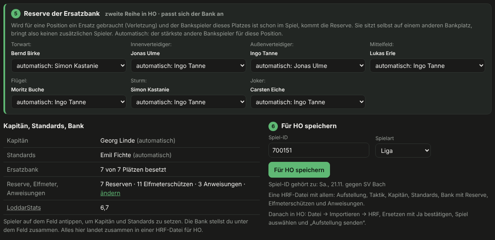
</details>
</details>

<details>
<summary><b>Gegner-Check</b>: wie stark ist der nächste Gegner?</summary>
<br>

Stärke des Gegners aus seinen letzten Pflichtspielen (HO-Gegnercheck), Ballbesitz und Duell für Duell gegen die eigene Elf.

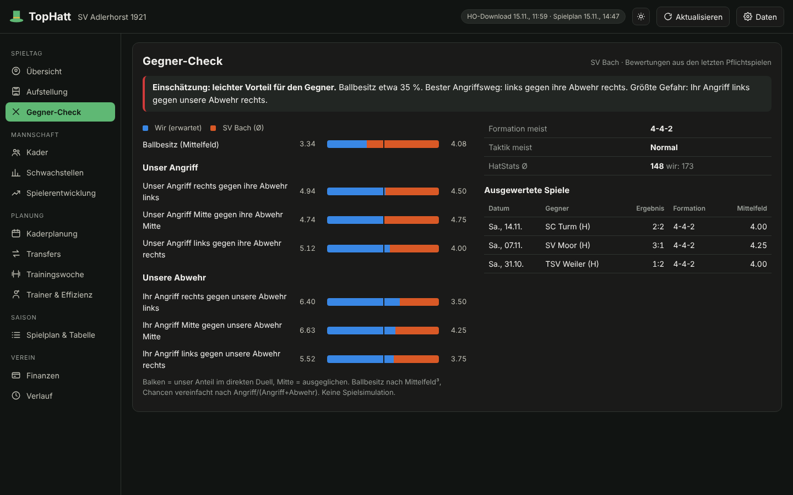
</details>

### Mannschaft

<details>
<summary><b>Kader</b>: wer ist einsatzbereit, und wo?</summary>
<br>

Kader nach Mannschaftsteilen mit Einsatzwert aus Positionsstärke, Kondition und Verletzung; jeder Spieler einmal,
wahlweise ausgewogen, nach bester Position oder wie aufgestellt.

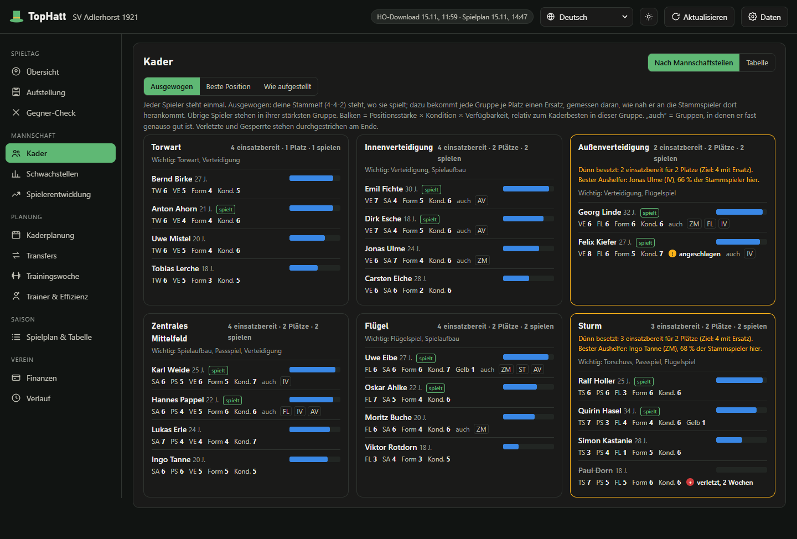
</details>

<details>
<summary><b>Schwachstellen</b>: wo verliert die Mannschaft am meisten?</summary>
<br>

Bewertung je Mannschaftsteil für die eigene Aufstellung, der stärkste Hebel und ein Vergleich aller Formationen.

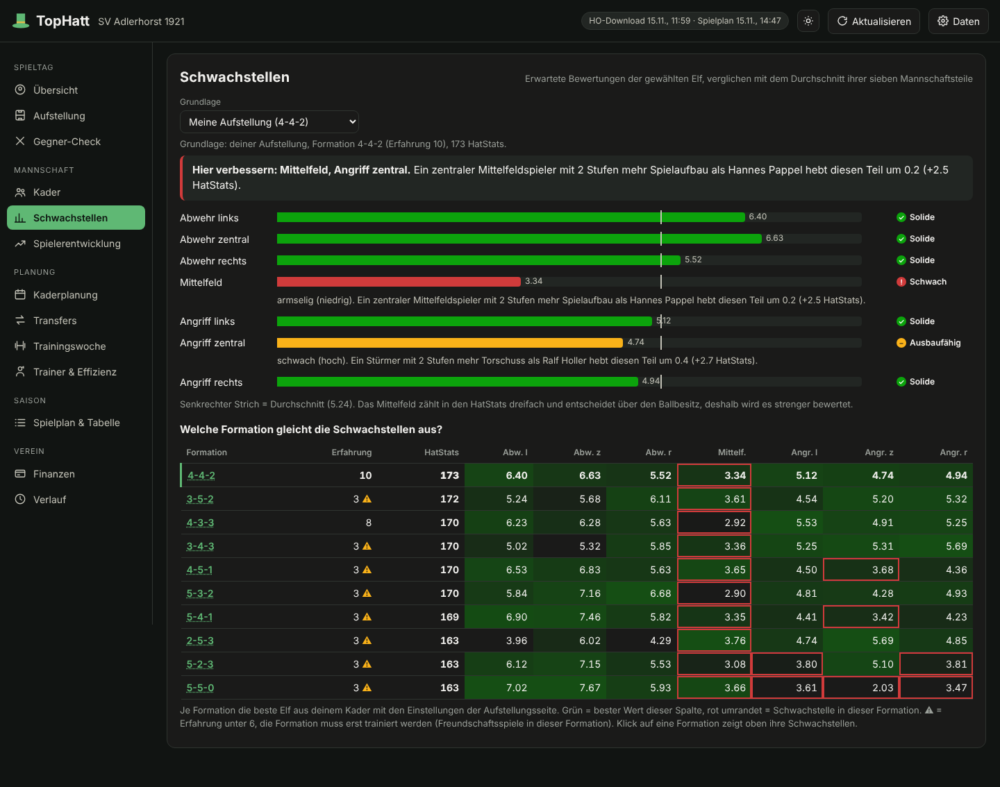
</details>

<details>
<summary><b>Spielerentwicklung</b>: wohin entwickelt sich ein Spieler?</summary>
<br>

Graph mit Prognose aus dem HO-Trainingsmodell, Altersabbau und Hinweis, wann ein Verkauf oder Ersatz ansteht.

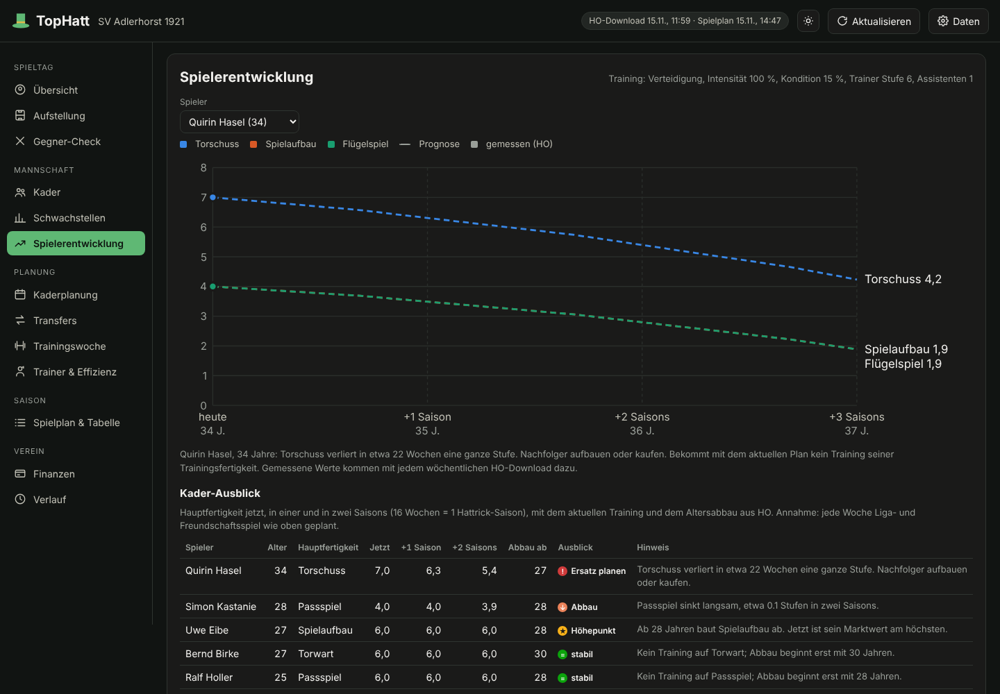
</details>

### Planung

<details>
<summary><b>Kaderplanung</b>: wo droht in ein, zwei Saisons eine Lücke?</summary>
<br>

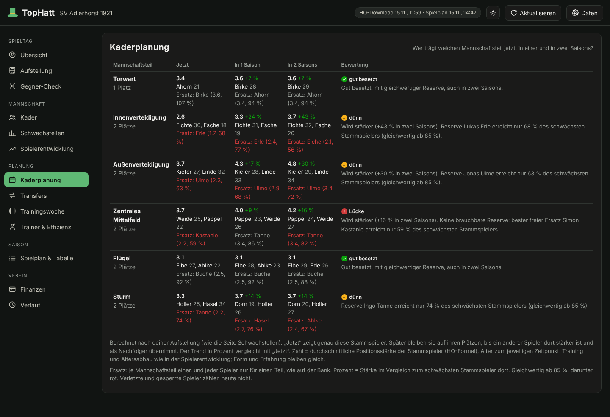
</details>

<details>
<summary><b>Transfers</b>: welche Verstärkung bringt am meisten?</summary>
<br>

Budget, Suchprofile für den Transfermarkt und Kandidaten passend zu den Schwachstellen.

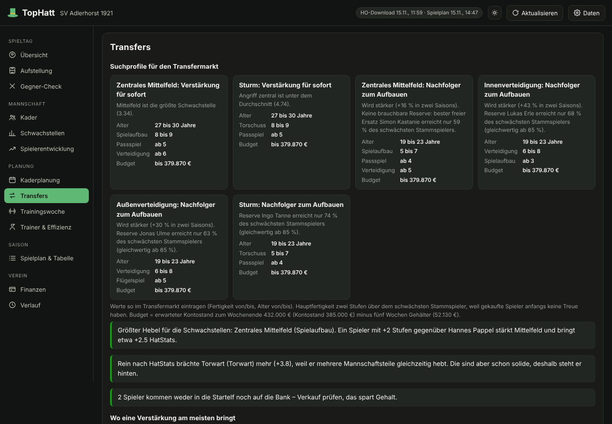
</details>

<details>
<summary><b>Trainingswoche</b>: wer spielt wo, damit möglichst viele trainieren?</summary>
<br>

A-Kader und B-Kader, Plan für Liga-, Pokal- und Freundschaftsspiel nach Trainingsnutzen.

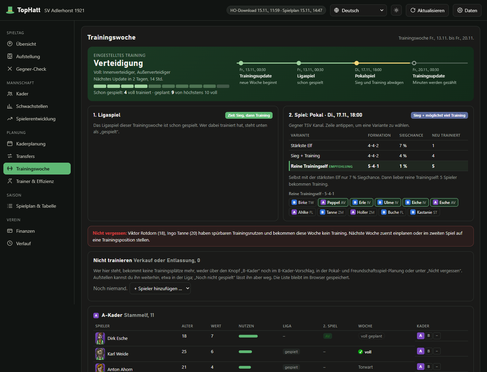
</details>

<details>
<summary><b>Trainer & Effizienz</b>: lohnt sich ein besserer Trainer?</summary>
<br>

Trainingseffizienz wie die Hattrick-Sandbox, Kosten je Effizienzpunkt, günstigste Wege zu mehr Effizienz und Trainerpreise.

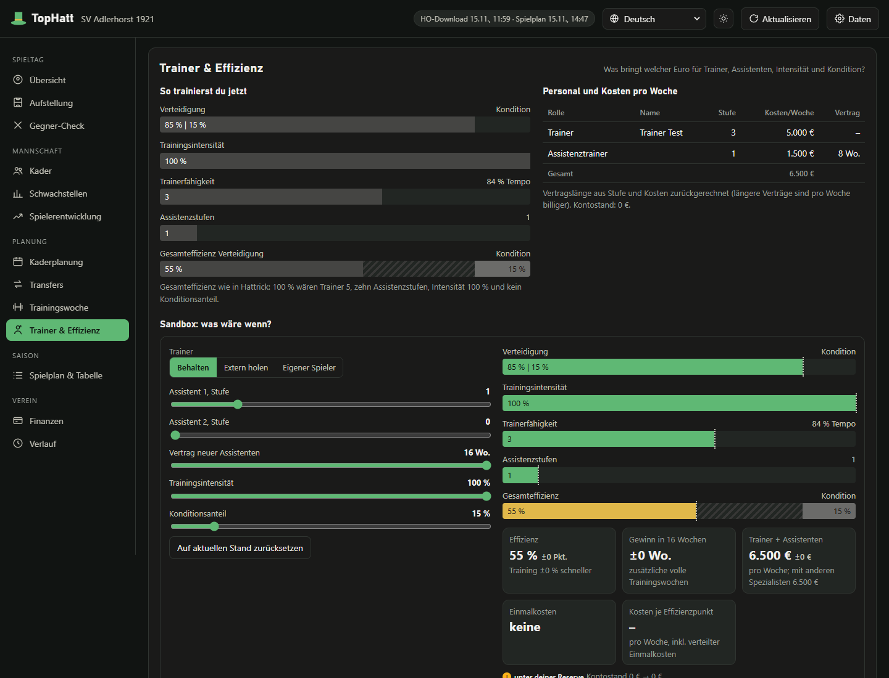
</details>

### Saison und Verein

<details>
<summary><b>Spielplan & Tabelle</b></summary>
<br>

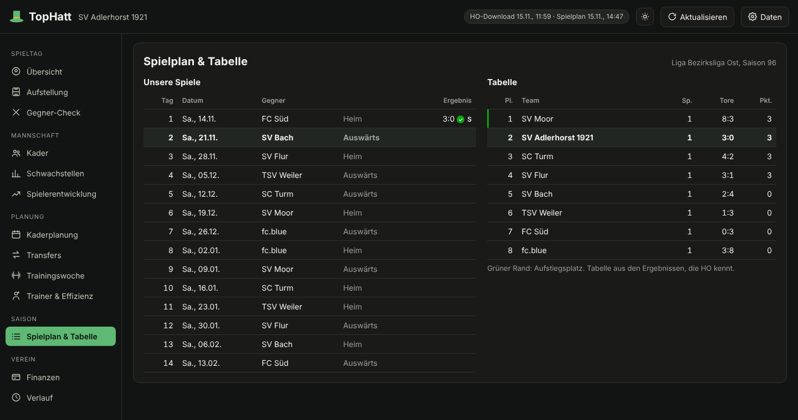
</details>

<details>
<summary><b>Finanzen</b>: kann sich der Verein das leisten?</summary>
<br>

Kontostand, Wochenbilanz, Personal und eine Ampel mit Prognose, ob geplante Ausgaben in die Schulden führen.

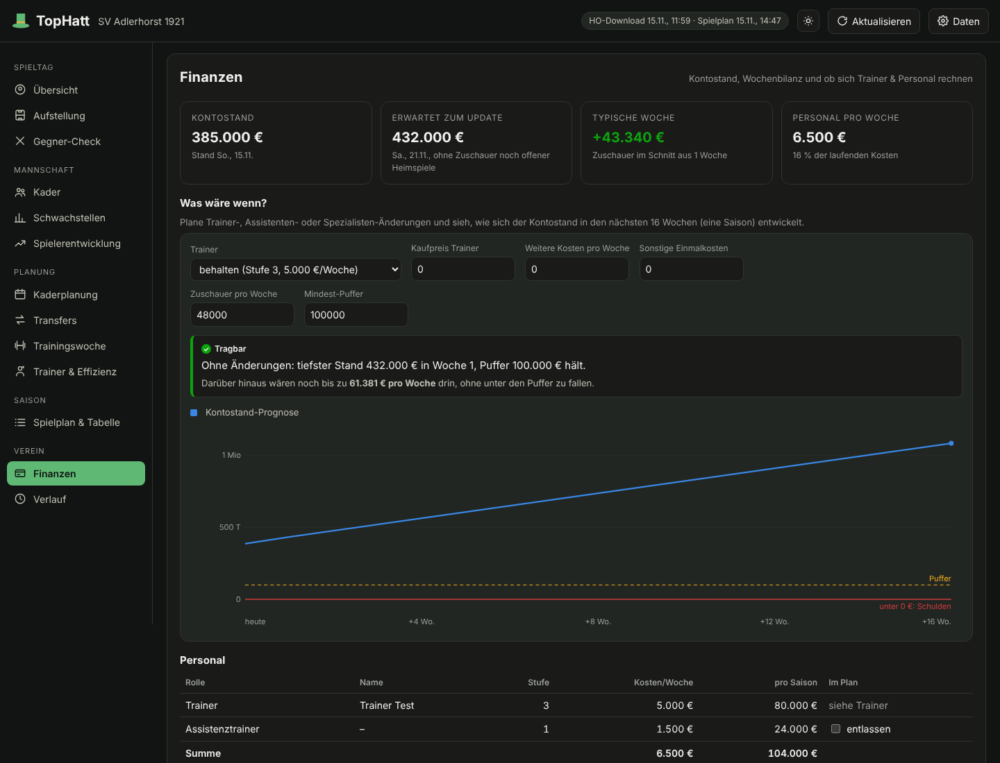
</details>

<details>
<summary><b>Verlauf</b>: geht der Plan über die Wochen auf?</summary>
<br>

Je Trainingswoche ein Schnappschuss von Training, Personal, Finanzen, Mannschaft und Kader; Export und Import als JSON.

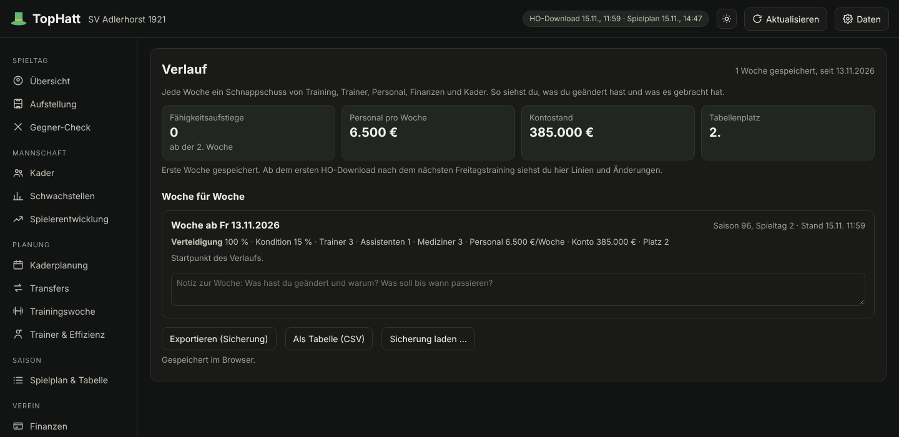
</details>

## Installieren

Ohne Build: unter [Releases](https://github.com/michelix/tophatt/releases/latest) die Datei `TopHatt-<Version>.zip`
herunterladen und entpacken. Darin liegen `TopHatt.bat`, `dist/tophatt.html` und `sync/TopHattSync.jar`.
Vorausgesetzt wird nur eine Installation von [Hattrick Organizer](https://github.com/ho-dev/HattrickOrganizer);
dessen Java wird für den Sync mitbenutzt. Nur die App ohne HO-Datenbank: `tophatt.html` aus dem Release reicht.

## Benutzen

1. In HO wie gewohnt die Daten herunterladen (am besten mit Gegnercheck). Die `.hrf`-Datei landet im HO-Datenordner,
   hier `F:\claude\hattrick\HO\daten`.
2. **`TopHatt.bat`** starten. Das liest die HO-Datenbank (nur lesend, über eine Kopie), schreibt
   `tophatt-data.json` in den Datenordner und öffnet `dist/tophatt.html`.
3. Beim ersten Mal in der App unter „Daten“ den Ordner verbinden (geht in Chrome und Edge). Danach lädt TopHatt beim
   Öffnen immer die neuesten Daten, „Aktualisieren“ liest sie neu ein. Ohne Ordner geht es auch: HRF-Datei und
   `tophatt-data.json` ins Fenster ziehen.
4. Aufstellung prüfen und „Für HO speichern“. In HO über Datei → Importieren → HRF einlesen und „Aufstellung senden“.

Die Pfade zu HO stehen oben in `TopHatt.bat` und lassen sich dort anpassen. Spielerbilder liest der Sync aus
`img/playersAvatar` der lokalen HO-Installation; sie bleiben auf dem eigenen Rechner und gehören nicht ins Repository.

## Aufbau

| Teil | Inhalt |
| --- | --- |
| `sync/` | TopHatt-Sync (Java 17): liest die HO-Datenbank (HSQLDB) und exportiert Spielplan, Tabelle, Spielerhistorie, Training, Gegnerbewertungen und Spielerbilder |
| `src/core/hrf.ts` | HRF-Dateien lesen und schreiben |
| `src/core/hodata.ts` | `tophatt-data.json` lesen, nächstes Spiel, Tabelle |
| `src/core/rating.ts`, `optimizer.ts` | Bewertungsformel aus HO und Aufstellungs-Optimierung |
| `src/core/editor.ts` | Manuelle Aufstellung bewerten, vervollständigen und mit dem Vorschlag vergleichen |
| `src/core/tactics.ts`, `matchplan.ts` | Taktik-Wirkung, Spielvorhersage und Empfehlung für Taktik, Einstellung, Ausrichtung |
| `src/core/substitutions.ts` | Auswechslungs-Vorschläge nach Kondition, Training und Einsatzzeit |
| `src/core/orders.ts` | Anweisungen, Elfmeterschützen und Reserve-Reihe im HRF-Format von HO |
| `src/core/opponent.ts` | Gegnerstärke aus den Spielbewertungen des Gegners, direkte Duelle |
| `src/core/weakness.ts` | Schwachstellen je Mannschaftsteil und stärkster Hebel |
| `src/core/squad.ts` | Kader nach Mannschaftsteilen und Kaderplanung |
| `src/core/development.ts` | Trainingszuwachs und Altersabbau (Formeln aus HO) |
| `src/core/training.ts`, `trainingweek.ts` | Trainingsplätze, A-/B-Kader und Wochenplan |
| `src/core/staff.ts` | Trainer, Assistenten, Spezialisten: Kosten und Trainingseffizienz |
| `src/core/finance.ts` | Kontostand, Wochenbilanz und Prognose |
| `src/core/history.ts` | Wochen-Schnappschüsse für den Verlauf |
| `src/core/scouting.ts`, `advisor.ts` | Suchprofile, Transfer- und Trainingshinweise |
| `src/ui/` | Oberfläche; `build.mjs` packt alles in eine HTML-Datei |

## Entwickeln

```
npm install
npm test          # Tests mit test/fixtures (anonymisierter Testverein)
npm run typecheck
npm run build     # erzeugt dist/tophatt.html (nicht im Repository, fertig gebaut im Release)

# TopHatt-Sync bauen (JDK 17+, hsqldb-2.7.4.jar aus HO)
javac --release 17 -cp hsqldb-2.7.4.jar -d sync/build sync/src/TopHattSync.java
jar cfe sync/TopHattSync.jar TopHattSync -C sync/build .
```

Zum Ausprobieren ohne eigene HO-Daten `tophatt.html` aus dem Release (oder nach dem Build `dist/tophatt.html`) öffnen und `test/fixtures/team.hrf` zusammen mit
`test/fixtures/tophatt-data.json` ins Fenster ziehen. Auf diesen Daten beruhen auch die Screenshots in `docs/img`
(Namen und einige Werte geändert, Spielerbilder ergänzt).

## Lizenz

Copyright © 2026 [michelix](https://github.com/michelix).

TopHatt steht unter der GNU Lesser General Public License, Version 3 oder später (LGPL-3.0-or-later);
siehe [`COPYING`](COPYING) und [`COPYING.LESSER`](COPYING.LESSER).

Bewertungsmodell, Spielvorhersage, Trainingspositionen, Trainings- und Abbauformeln, Konditionsverlauf sowie
Kapitäns-, Standard- und Elfmeterschützenwahl sind aus Hattrick Organizer
(https://github.com/ho-dev/HattrickOrganizer, LGPL-3.0, © die HO-Entwickler) portiert. Formeln: Schum.
Deshalb steht auch TopHatt unter der LGPL.

TopHatt ist ein privates Hilfsprogramm und steht in keiner Verbindung zu Hattrick.
