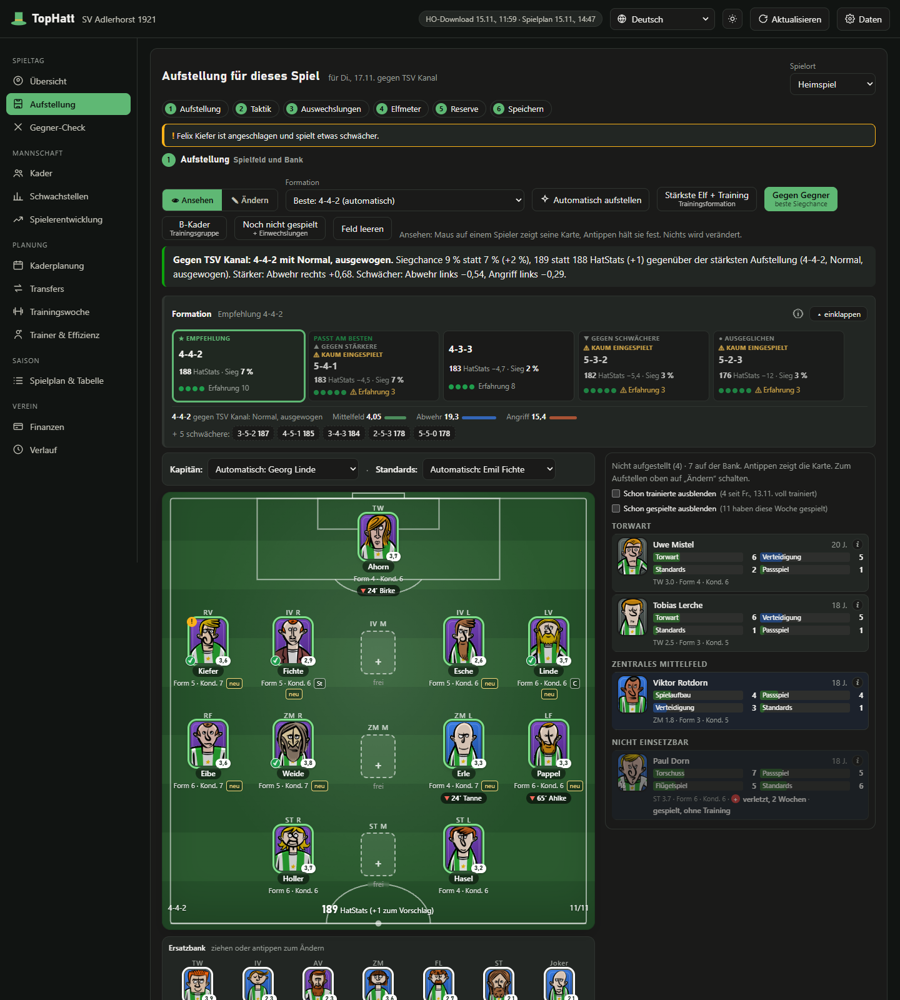
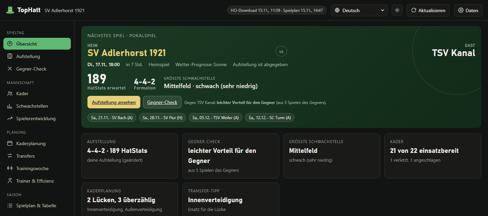
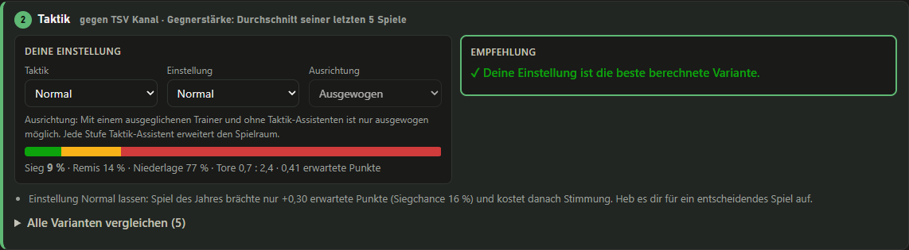
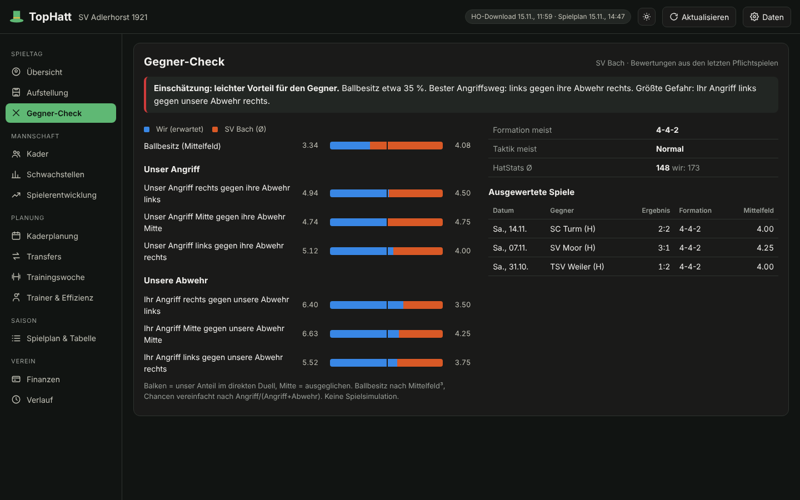
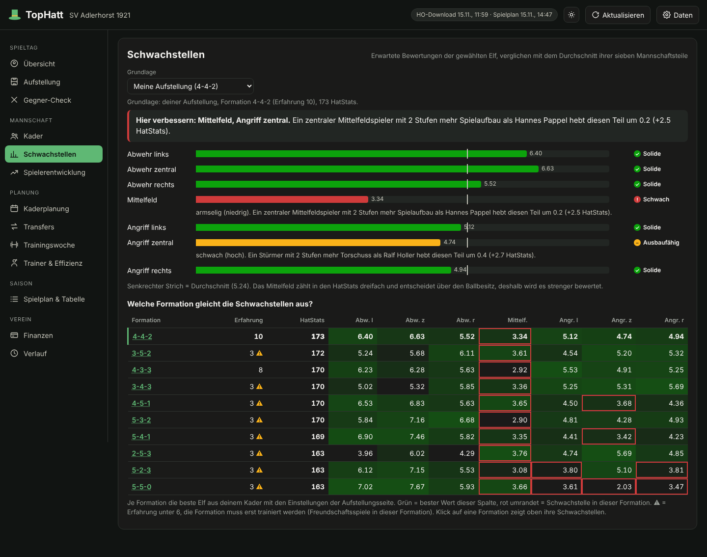
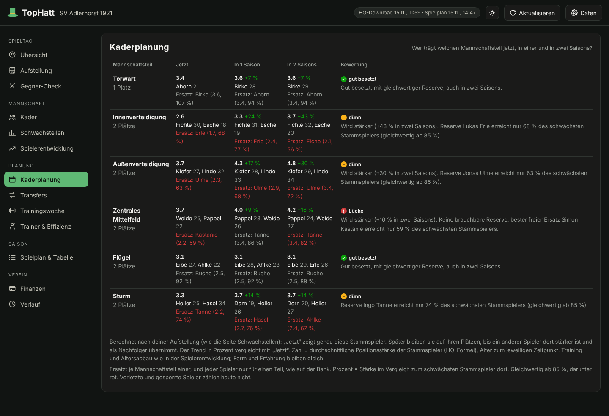
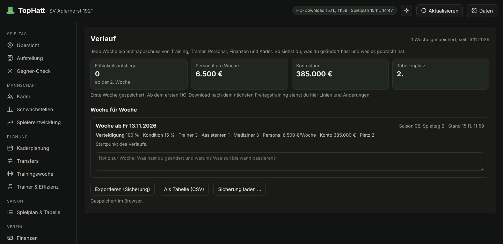

# TopHatt

🇬🇧 **English** | [🇩🇪 Deutsch](README.de.md)

TopHatt is a match-day cockpit for [Hattrick](https://www.hattrick.org). It reads your data from
Hattrick Organizer (HO), suggests the lineup, tactics and substitutions for the next match, and writes the result
back as an HRF file that HO uploads to Hattrick. Everything runs locally in the browser, in light or dark mode.



<sub>All screenshots show a made-up club with made-up players and values; the player pictures are Hattrick avatars from HO.
The app itself is in German, so the screenshots are too; German labels are given in quotes below.</sub>

**Contents:** [Pages](#pages) · [Install](#install) · [Usage](#usage) · [Structure](#structure) · [Development](#development) · [License](#license)

## Pages

The pages follow the menu on the left of the app. Every section can be expanded.

### Match day

<details open>
<summary><b>Overview</b> („Übersicht“): the next match at a glance</summary>
<br>

Opponent, kick-off, expected HatStats, formation, biggest weak spot and the upcoming matches. Below that, tiles that
lead straight to the matching page.


</details>

<details open>
<summary><b>Lineup</b> („Aufstellung“): six steps to a finished HRF file</summary>
<br>

Pitch laid out as in HO (goalkeeper at the top). The numbered buttons at the top jump to each section.

<details open>
<summary>1 · Pitch and bench</summary>
<br>

- Formation suggestions as cards, familiar formations first; “auto lineup”, “training eleven” and “clear pitch” buttons.
- **View/Edit** („Ansehen/Ändern“): in view mode, hovering over a player shows their card and a click pins it, so nothing
  moves by accident. In edit mode, drag or tap players; lines show where a player fits best.
- Frame colour = suitability for the position, circle colour = squad group (A purple, B blue, rest grey),
  arrows = planned substitutions with minute.

**Player clicked:** the player card shows age, TSI, wage, form, stamina, all skills, the best positions (in the same
colours as the lines on the pitch) and the latest match rating.


</details>

<details>
<summary>2 · Tactics</summary>
<br>

Recommended tactic, team attitude and style of play from HO's match prediction against the opponent's strength, with
win, draw and loss chances. Styles of play are only offered as far as coach type and tactical assistants allow.


</details>

<details>
<summary>3 · Substitutions and orders</summary>
<br>

Suggestions based on stamina, training and playing time, with the goals **Win**, **Balanced** or **Training**.
**Automatic** adapts the substitutions to every change of the lineup, **Manual** leaves them as they are. Below them
the match orders as in HO; anything that no longer fits the lineup is flagged.


</details>

<details>
<summary>4 · Penalty takers</summary>
<br>

Order as in HO, from experience, set pieces and scoring; automatic or sorted by hand.


</details>

<details>
<summary>5 · Reserves and 6 · Save</summary>
<br>

The reserves are the second row of the bench: automatically the strongest other bench player per position.
“Save for HO” writes an HRF file with lineup, tactics, captain, set pieces taker, bench, reserves, penalty takers and orders.


</details>
</details>

<details>
<summary><b>Opponent check</b> („Gegner-Check“): how strong is the next opponent?</summary>
<br>

The opponent's strength from their latest competitive matches (HO's opponent check), possession, and a duel-by-duel
comparison against your own eleven.


</details>

### Team

<details>
<summary><b>Squad</b> („Kader“): who is available, and where?</summary>
<br>

Squad by team section, with a match value from position strength, stamina and injury; every player once, either
balanced, by best position or as lined up.


</details>

<details>
<summary><b>Weak spots</b> („Schwachstellen“): where does the team lose the most?</summary>
<br>

Rating per team section for your own lineup, the biggest lever, and a comparison of all formations.


</details>

<details>
<summary><b>Player development</b> („Spielerentwicklung“): where is a player heading?</summary>
<br>

Chart with a forecast from HO's training model, age decline, and a hint when it is time to sell or find a replacement.


</details>

### Planning

<details>
<summary><b>Squad planning</b> („Kaderplanung“): where will a gap open in one or two seasons?</summary>
<br>


</details>

<details>
<summary><b>Transfers</b>: which signing helps the most?</summary>
<br>

Budget, search profiles for the transfer market and candidates that match the weak spots.


</details>

<details>
<summary><b>Training week</b> („Trainingswoche“): who plays where so that as many as possible train?</summary>
<br>

A squad and B squad, and a plan for league, cup and friendly matches by training benefit.


</details>

<details>
<summary><b>Coach & efficiency</b> („Trainer & Effizienz“): is a better coach worth it?</summary>
<br>

Training efficiency as in Hattrick's sandbox, cost per efficiency point, the cheapest ways to more efficiency, and coach prices.


</details>

### Season and club

<details>
<summary><b>Fixtures & table</b> („Spielplan & Tabelle“)</summary>
<br>


</details>

<details>
<summary><b>Finances</b> („Finanzen“): can the club afford it?</summary>
<br>

Cash, weekly balance, staff, and a traffic light with a forecast of whether planned spending leads into debt.


</details>

<details>
<summary><b>History</b> („Verlauf“): is the plan working out over the weeks?</summary>
<br>

One snapshot per training week of training, staff, finances, team and squad; export and import as JSON.


</details>

## Install

No build needed: download `TopHatt-<version>.zip` from [Releases](https://github.com/michelix/tophatt/releases/latest)
and unzip it. It contains `TopHatt.bat`, `dist/tophatt.html` and `sync/TopHattSync.jar`.
The only requirement is an installation of [Hattrick Organizer](https://github.com/ho-dev/HattrickOrganizer);
its Java runtime is reused for the sync. For the app alone, without the HO database, `tophatt.html` from the release is enough.

## Usage

1. Download your data in HO as usual (ideally with the opponent check). The `.hrf` file ends up in HO's data folder,
   for example `F:\claude\hattrick\HO\daten`.
2. Start **`TopHatt.bat`**. It reads the HO database (read-only, from a copy), writes `tophatt-data.json` into the
   data folder and opens `dist/tophatt.html`.
3. The first time, connect the folder in the app under “Daten” (works in Chrome and Edge). From then on TopHatt always
   loads the latest data when opened; “Aktualisieren” (refresh) reads them again. It also works without a folder: drag
   the HRF file and `tophatt-data.json` into the window.
4. Check the lineup and click “Für HO speichern” (save for HO). In HO, use File → Import → read HRF, then “send lineup”.

The paths to HO are at the top of `TopHatt.bat` and can be changed there. The sync reads player pictures from
`img/playersAvatar` of the local HO installation; they stay on your own computer and do not belong in the repository.

## Structure

| Part | Contents |
| --- | --- |
| `sync/` | TopHatt sync (Java 17): reads the HO database (HSQLDB) and exports fixtures, table, player history, training, opponent ratings and player pictures |
| `src/core/hrf.ts` | Read and write HRF files |
| `src/core/hodata.ts` | Read `tophatt-data.json`, next match, table |
| `src/core/rating.ts`, `optimizer.ts` | Rating formula from HO and lineup optimisation |
| `src/core/editor.ts` | Rate, complete and compare a manual lineup with the suggestion |
| `src/core/tactics.ts`, `matchplan.ts` | Tactic effects, match prediction and recommendation for tactic, attitude and style of play |
| `src/core/substitutions.ts` | Substitution suggestions by stamina, training and playing time |
| `src/core/orders.ts` | Match orders, penalty takers and bench reserves in HO's HRF format |
| `src/core/opponent.ts` | Opponent strength from their match ratings, direct duels |
| `src/core/weakness.ts` | Weak spots per team section and biggest lever |
| `src/core/squad.ts` | Squad by team section and squad planning |
| `src/core/development.ts` | Training gains and age decline (formulas from HO) |
| `src/core/training.ts`, `trainingweek.ts` | Training slots, A/B squad and weekly plan |
| `src/core/staff.ts` | Coach, assistants, specialists: costs and training efficiency |
| `src/core/finance.ts` | Cash, weekly balance and forecast |
| `src/core/history.ts` | Weekly snapshots for the history page |
| `src/core/scouting.ts`, `advisor.ts` | Search profiles, transfer and training hints |
| `src/ui/` | User interface; `build.mjs` bundles everything into one HTML file |

## Development

```
npm install
npm test          # tests with test/fixtures (anonymised test club)
npm run typecheck
npm run build     # creates dist/tophatt.html (not in the repository, prebuilt in each release)

# Build the TopHatt sync (JDK 17+, hsqldb-2.7.4.jar from HO)
javac --release 17 -cp hsqldb-2.7.4.jar -d sync/build sync/src/TopHattSync.java
jar cfe sync/TopHattSync.jar TopHattSync -C sync/build .
```

To try it without your own HO data, open `tophatt.html` from the release (or `dist/tophatt.html` after a build) and
drag `test/fixtures/team.hrf` together with `test/fixtures/tophatt-data.json` into the window. The screenshots in
`docs/img` are based on this data (names and some values changed, player pictures added).

## License

Copyright © 2026 [michelix](https://github.com/michelix).

TopHatt is licensed under the GNU Lesser General Public License, version 3 or later (LGPL-3.0-or-later);
see [`COPYING`](COPYING) and [`COPYING.LESSER`](COPYING.LESSER).

The rating model, match prediction, training positions, training and decline formulas, stamina curve, and the choice
of captain, set pieces taker and penalty takers are ported from Hattrick Organizer
(https://github.com/ho-dev/HattrickOrganizer, LGPL-3.0, © the HO developers). Formulas: Schum.
That is why TopHatt is licensed under the LGPL as well.

TopHatt is a private helper tool and is not affiliated with Hattrick.
