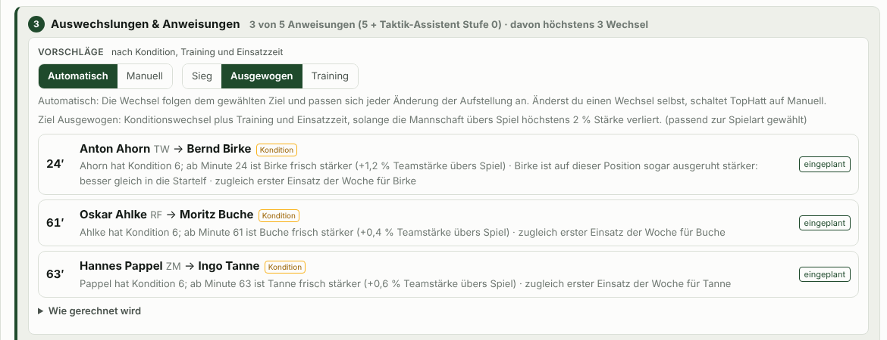
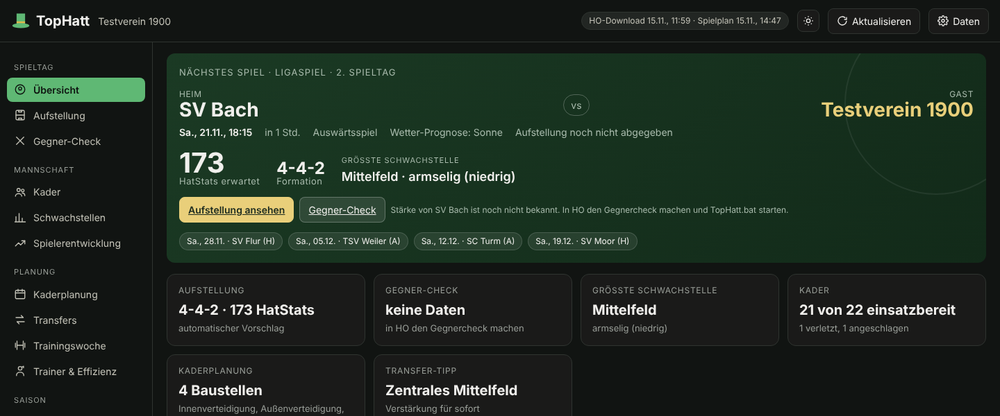

# TopHatt

TopHatt ist ein Spieltags-Cockpit für [Hattrick](https://www.hattrick.org). Es liest die Daten aus
Hattrick Organizer (HO), schlägt Aufstellung, Taktik und Wechsel für das nächste Spiel vor und schreibt
das Ergebnis als HRF-Datei zurück, die HO zu Hattrick hochlädt. Alles läuft lokal im Browser.


<sub>Alle Screenshots zeigen den anonymisierten Testverein aus `test/fixtures` mit den eigenen TopHatt-Spielerbildern.</sub>

## Was TopHatt kann

### Spieltag

- **Übersicht**: das nächste Spiel mit erwarteten HatStats, Formation, größter Schwachstelle und den folgenden Spielen.
- **Aufstellung**: Spielfeld wie in HO (Torwart oben). Die Seite ist in sechs nummerierte Bereiche gegliedert:
  1. **Spielfeld und Bank**: Formationsvorschlag als Karten (eingespielte Formationen zuerst), „Automatisch aufstellen“,
     Trainingself, Spieler per Drag-and-drop oder Antippen aufstellen. Der Umschalter **Ansehen/Ändern** schützt vor
     versehentlichem Verschieben. Eine **Spielerkarte** neben dem Feld zeigt Fertigkeiten, Form, Kondition und Verletzungen,
     passende Positionen werden auf dem Feld hervorgehoben. Spielerbilder kommen aus HO; fehlt eins, zeichnet TopHatt
     ein eigenes. Kaderfarben zeigen A-Kader, B-Kader und Rest.
  2. **Taktik**: Empfehlung für Taktik, Einstellung und Ausrichtung aus der HO-Spielvorhersage, nur im Rahmen von
     Trainertyp und Taktik-Assistenten.
  3. **Auswechslungen und Anweisungen**: Vorschläge nach Kondition, Training und Einsatzzeit mit den Zielen Sieg,
     Ausgewogen oder Training. **Automatisch** passt die Wechsel jeder Änderung der Aufstellung an, **Manuell** lässt sie
     stehen. Geplante Wechsel erscheinen mit Minute auf Feld und Bank; Anweisungen, die nicht mehr zur Aufstellung passen,
     werden markiert.
  4. **Elfmeterschützen**: Reihenfolge wie in HO, automatisch oder von Hand.
  5. **Reserve der Ersatzbank**: die zweite Bankreihe, automatisch der stärkste andere Bankspieler je Position.
  6. **Speichern**: eine HRF-Datei mit Aufstellung, Taktik, Kapitän, Standards, Bank, Reserve, Elfmeterschützen und
     Anweisungen für den Import in HO.
- **Gegner-Check**: Stärke des Gegners aus seinen letzten Pflichtspielen (HO-Gegnercheck), Duell für Duell gegen die eigene Elf.



### Mannschaft und Planung

- **Kader** nach Mannschaftsteilen mit Einsatzwert aus Positionsstärke, Kondition und Verletzung.
- **Schwachstellen** je Mannschaftsteil für die eigene Aufstellung und Formation, mit dem stärksten Hebel.
- **Spielerentwicklung** als Graph mit Prognose aus dem HO-Trainingsmodell und Alterswarnung.
- **Kaderplanung**: wer trägt welchen Mannschaftsteil jetzt, in einer und in zwei Saisons, wo droht eine Lücke.
- **Transfers**: Budget, Suchprofile für den Transfermarkt und Hinweise passend zu den Schwachstellen.
- **Trainingswoche**: A-Kader und B-Kader, Plan für Liga-, Pokal- und Freundschaftsspiel nach Trainingsnutzen,
  schon trainierte Spieler ausblenden.
- **Trainer & Effizienz**: Trainingseffizienz wie die Hattrick-Sandbox, Kosten je Effizienzpunkt, günstigste Wege
  zu mehr Effizienz und Trainerpreise.

### Saison und Verein

- **Spielplan & Tabelle** der Liga.
- **Finanzen**: Kontostand, Wochenbilanz, Personal und eine Ampel mit Prognose, ob geplante Ausgaben in die Schulden führen.
- **Verlauf**: je Trainingswoche ein Schnappschuss von Training, Personal, Finanzen, Mannschaft und Kader, damit sich
  der Plan über Wochen prüfen lässt. Export und Import als JSON.

Oben rechts schaltet ein Knopf zwischen **hell und dunkel**; die Wahl bleibt gespeichert.



## Benutzen

1. In HO wie gewohnt die Daten herunterladen (am besten mit Gegnercheck). Die `.hrf`-Datei landet im HO-Datenordner,
   hier `F:\claude\hattrick\HO\daten`.
2. **`TopHatt.bat`** starten. Das liest die HO-Datenbank (nur lesend, über eine Kopie), schreibt
   `tophatt-data.json` in den Datenordner und öffnet `dist/tophatt.html`.
3. Beim ersten Mal in der App unter „Daten“ den Ordner verbinden (geht in Chrome und Edge). Danach lädt TopHatt beim
   Öffnen immer die neuesten Daten, „Aktualisieren“ liest sie neu ein. Ohne Ordner geht es auch: HRF-Datei und
   `tophatt-data.json` ins Fenster ziehen.
4. Aufstellung prüfen und „Für HO speichern“. In HO über Datei → Importieren → HRF einlesen und „Aufstellung senden“.

Die Pfade zu HO stehen oben in `TopHatt.bat` und lassen sich dort anpassen. Spielerbilder liest der Sync aus
`img/playersAvatar` der lokalen HO-Installation; sie bleiben auf dem eigenen Rechner und gehören nicht ins Repository.

## Aufbau

| Teil | Inhalt |
| --- | --- |
| `sync/` | TopHatt-Sync (Java 17): liest die HO-Datenbank (HSQLDB) und exportiert Spielplan, Tabelle, Spielerhistorie, Training, Gegnerbewertungen und Spielerbilder |
| `src/core/hrf.ts` | HRF-Dateien lesen und schreiben |
| `src/core/hodata.ts` | `tophatt-data.json` lesen, nächstes Spiel, Tabelle |
| `src/core/rating.ts`, `optimizer.ts` | Bewertungsformel aus HO und Aufstellungs-Optimierung |
| `src/core/editor.ts` | Manuelle Aufstellung bewerten, vervollständigen und mit dem Vorschlag vergleichen |
| `src/core/tactics.ts`, `matchplan.ts` | Taktik-Wirkung, Spielvorhersage und Empfehlung für Taktik, Einstellung, Ausrichtung |
| `src/core/substitutions.ts` | Auswechslungs-Vorschläge nach Kondition, Training und Einsatzzeit |
| `src/core/orders.ts` | Anweisungen, Elfmeterschützen und Reserve-Reihe im HRF-Format von HO |
| `src/core/opponent.ts` | Gegnerstärke aus den Spielbewertungen des Gegners, direkte Duelle |
| `src/core/weakness.ts` | Schwachstellen je Mannschaftsteil und stärkster Hebel |
| `src/core/squad.ts` | Kader nach Mannschaftsteilen und Kaderplanung |
| `src/core/development.ts` | Trainingszuwachs und Altersabbau (Formeln aus HO) |
| `src/core/training.ts`, `trainingweek.ts` | Trainingsplätze, A-/B-Kader und Wochenplan |
| `src/core/staff.ts` | Trainer, Assistenten, Spezialisten: Kosten und Trainingseffizienz |
| `src/core/finance.ts` | Kontostand, Wochenbilanz und Prognose |
| `src/core/history.ts` | Wochen-Schnappschüsse für den Verlauf |
| `src/core/scouting.ts`, `advisor.ts` | Suchprofile, Transfer- und Trainingshinweise |
| `src/ui/` | Oberfläche; `build.mjs` packt alles in eine HTML-Datei |

## Entwickeln

```
npm install
npm test          # Tests mit test/fixtures (anonymisierter Testverein)
npm run typecheck
npm run build     # erzeugt dist/tophatt.html

# TopHatt-Sync bauen (JDK 17+, hsqldb-2.7.4.jar aus HO)
javac --release 17 -cp hsqldb-2.7.4.jar -d sync/build sync/src/TopHattSync.java
jar cfe sync/TopHattSync.jar TopHattSync -C sync/build .
```

Zum Ausprobieren ohne eigene HO-Daten `dist/tophatt.html` öffnen und `test/fixtures/team.hrf` zusammen mit
`test/fixtures/tophatt-data.json` ins Fenster ziehen. So sind auch die Screenshots in `docs/img` entstanden.

## Lizenz

Bewertungsmodell, Spielvorhersage, Trainingspositionen, Trainings- und Abbauformeln, Konditionsverlauf sowie
Kapitäns-, Standard- und Elfmeterschützenwahl sind aus Hattrick Organizer
(https://github.com/ho-dev/HattrickOrganizer, LGPL-3.0) portiert. Formeln: Schum.
TopHatt steht daher ebenfalls unter LGPL-3.0. TopHatt ist ein privates Hilfsprogramm
und steht in keiner Verbindung zu Hattrick.
